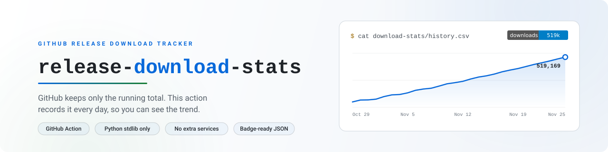

<div align="center">

<picture>
  <source media="(prefers-color-scheme: dark)" srcset="docs/banner-dark.svg">
  <source media="(prefers-color-scheme: light)" srcset="docs/banner-light.svg">
  
</picture>

[](https://github.com/shenxianpeng/release-download-stats/actions/workflows/test.yml)
[](https://github.com/shenxianpeng/release-download-stats/releases)
[](LICENSE)

GitHub counts how often each release file is downloaded, but keeps only the running total. This action records the counts of every release once a day, so you can see how they grow.

</div>

Each run commits two files to a branch of your repository (`download-stats` by default):

- `stats.json`: the total now, per release and, optionally, per group of files.
- `history.csv`: one row per day with the total.

It needs nothing but the token of the workflow run: a short Python script that uses only the standard library, no extra tools or services.

## Usage

> [!TIP]
> `@v1` always points to the latest `v1.x.y` release. Pin an exact version (for example `@v1.0.0`) or a commit SHA if you prefer.

```yaml
name: Download stats

on:
  schedule:
    - cron: '20 5 * * *'
  workflow_dispatch:

permissions: {}

concurrency:
  group: download-stats

jobs:
  stats:
    runs-on: ubuntu-latest
    permissions:
      contents: write
    steps:
      - uses: shenxianpeng/release-download-stats@v1
```

## Inputs

| Input | Default | Description |
| --- | --- | --- |
| `repository` | the current one | Repository whose releases are counted and where the branch is kept. |
| `exclude` | checksums and signatures | Regular expression of file names not to count. |
| `group` | none | Regular expression with named groups. Each group counts the downloads per value it matched (see below). |
| `branch` | `download-stats` | Branch that the files are committed to. It is created on the first run. |
| `publish` | `true` | Set to `false` to only count, for example in pull requests. |
| `token` | `github.token` | Token that reads the releases and pushes the branch. |

Outputs: `total` (for example `519169`) and `total-short` (`519k`). The job summary shows the total and the groups.

## Groups

With release files named like `clang-format-22_linux-amd64`,

```yaml
      - uses: shenxianpeng/release-download-stats@v1
        with:
          group: '-(?P<version>\d+)_(?P<platform>[a-z0-9]+-[a-z0-9]+)'
```

adds the downloads per version and per platform to `stats.json`:

```json
{
  "repository": "owner/repo",
  "generated_at": "2026-11-25T05:20:00Z",
  "total": 519169,
  "total_short": "519k",
  "releases": { "v1.2.0": 2548, "v1.1.0": 879 },
  "groups": {
    "platform": { "linux-amd64": 272361, "windows-amd64": 151287 },
    "version": { "22": 92369, "12": 74367 }
  }
}
```

## Showing the numbers

The files are on a branch, so they can be read from `raw.githubusercontent.com`, which allows requests from any web page. Replace `OWNER/REPO` below with your repository; the branch is `download-stats` unless you changed `branch`.

### Badge

A [dynamic JSON badge](https://shields.io/badges/dynamic-json-badge) from shields.io reads `stats.json` and updates by itself after every run:

| Badge in your README | `query` |
| --- | --- |
|  | `$.total_short` |
|  | `$.total` |
|  | `$.groups.platform["linux-amd64"]` (one value of a [group](#groups)) |
|  | `$.total_short`, with `&style=for-the-badge&logo=github` |

<sub>The numbers above are an example; your badge shows your own.</sub>

The first one, ready to copy:

```markdown
[](https://github.com/OWNER/REPO/releases)
```

For another row, change `query` (URL-encoded) and `label`. Every [shields.io style](https://shields.io/badges/dynamic-json-badge) works too: `color`, `style`, `logo`.

### Chart

`history.csv` has one row per day:

```csv
date,total
2026-11-24,517802
2026-11-25,519169
```

A web page can `fetch()` it, or `stats.json`, and draw a chart with any library. The difference between two rows is the downloads of that day.

## Notes

- Counts include downloads by CI jobs, so they show use, not users.
- GitHub does not count the source code archives (`.zip` and `.tar.gz` of the tag).
- `history.csv` starts on the day of the first run: GitHub keeps no earlier counts.
- If a ruleset protects every branch, allow GitHub Actions to push to the stats branch.

## License

[MIT](LICENSE)
